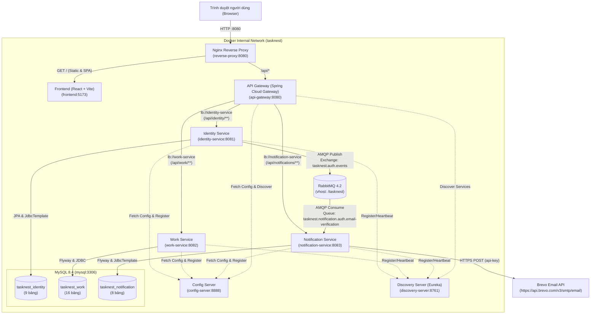
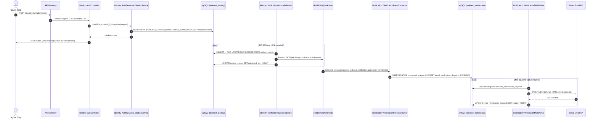
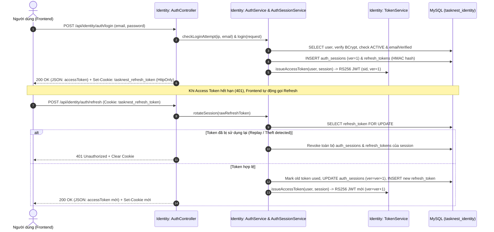
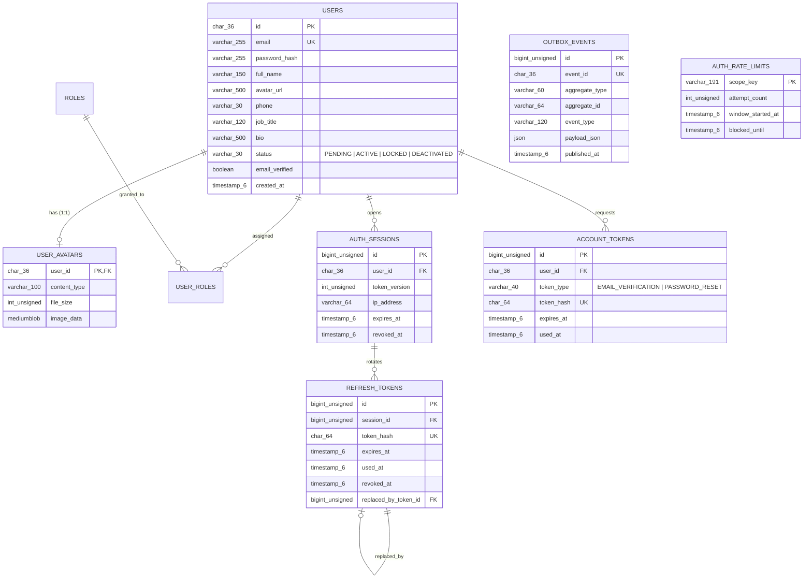

# TÀI LIỆU ONBOARDING & KIẾN TRÚC HỆ THỐNG — DỰ ÁN TASKNEST (OJT4)

> **Phạm vi khảo sát:** Đã đọc và đối chiếu trực tiếp 100% các module trong repository (`platform/*`, `services/*`, `frontend/*`, `infra/*`, `scripts/*`, `docs/*`, `.github/workflows/ci.yml`, `pom.xml`, `README.md`, `BACKENDOUTLOOK.md`).
>
> **Quy ước đánh nhãn bằng chứng trong tài liệu:**
> - **[Đã xác nhận trong code]**: Có mã nguồn, cấu hình hoặc migration thực thi trực tiếp.
> - **[Chỉ có trong tài liệu / migration]**: Đã có bảng DB (Flyway) hoặc mô tả trong `docs/` / `README.md`, nhưng chưa có tầng xử lý nghiệp vụ Java/Frontend.
> - **[Suy luận]**: Kết luận rút ra hợp lý từ cấu hình/code hiện tại.
> - **[Chưa xác định]**: Không có đủ thông tin trong repository, cần hỏi người bàn giao.

---

## 1. Tóm tắt dự án trong 1 phút

### 1.1. Mục đích & Bài toán nghiệp vụ
- **TaskNest** là hệ thống **Quản lý công việc và cộng tác nhóm (Work & Project Management Platform)** tương tự Jira/Trello, được phát triển trong khuôn khổ kỳ thực tập OJT4 (**[Đã xác nhận trong code]**: `README.md`, `docs/SRS.md.txt`).
- **Đối tượng sử dụng** (**[Chỉ có trong tài liệu]** `docs/SRS.md.txt`):
  - **System Admin**: Quản trị người dùng và hệ thống.
  - **Project Manager (PM) / Workspace Owner**: Quản lý Workspace, Project, Sprint, phân công công việc, xem báo cáo tiến độ.
  - **Team Member**: Cập nhật trạng thái Task (Kanban/List), bình luận, đính kèm tệp, log thời gian làm việc, nhận thông báo.
  - **Viewer / Guest**: Xem tiến độ dự án với quyền chỉ đọc.

### 1.2. Trạng thái triển khai thực tế (Code vs. Tài liệu)

| Phân hệ / Chức năng | Trạng thái thực tế | Bằng chứng trong Repository |
| :--- | :--- | :--- |
| **Hạ tầng Microservices** (Config Server, Eureka, API Gateway, MySQL, RabbitMQ, Nginx) | **[Đã xác nhận trong code]** (Hoàn chỉnh) | `platform/config-server`, `platform/discovery-server`, `platform/api-gateway`, `infra/compose/compose.yml` |
| **Đăng ký, Đăng nhập, Refresh Token (Cookie rotation), Logout, Logout-all** | **[Đã xác nhận trong code]** (Hoàn chỉnh E2E) | Backend: `AuthController.java`, `AuthService.java`, `TokenService.java`. Frontend: `features/auth/*` |
| **Xác thực Email bất đồng bộ** (Transactional Outbox + RabbitMQ + Brevo API) | **[Đã xác nhận trong code]** (Hoàn chỉnh E2E) | `VerificationOutboxPublisher.java` (`identity-service`) -> RabbitMQ -> `VerificationEventConsumer.java`, `VerificationMailWorker.java` (`notification-service`) |
| **Quản lý Hồ sơ cá nhân & Upload/Xóa Avatar** (Lưu BLOB trong DB) | **[Đã xác nhận trong code]** (Hoàn chỉnh E2E) | Backend: `ProfileController.java`, `ProfileService.java`, `V5__add_personal_profile.sql`. Frontend: `features/profile/*` |
| **Quên mật khẩu / Đặt lại mật khẩu / Đổi mật khẩu** | **[Chưa hoàn thiện - Mới có DTO & UI tĩnh]** | Backend chỉ có DTO `ForgotPasswordRequest.java`, `ResetPasswordRequest.java` và enum `AccountToken.TokenType.PASSWORD_RESET`, **chưa có endpoint hay hàm xử lý trong `AuthController` / `AuthService`**. Frontend có `ForgotPasswordPage.tsx` nhưng chỉ giả lập trạng thái thành công trên UI, không gọi API. |
| **Quản lý Workspace, Project, Kanban Board, Task, Comment, Attachment, Time Log** (`work-service`) | **[Chỉ có trong tài liệu / migration]** | Đã có đủ **16 bảng DB** trong `services/work-service/src/main/resources/db/migration/V1..V3`, nhưng code Java chỉ có `StatusController.java` (`GET /api/work/status`). Các package `domain`, `application`, `infrastructure` chỉ có file `package-info.java` rỗng. Frontend `DashboardPage.tsx` đang dùng dữ liệu tĩnh (mock). |
| **Thông báo In-app, WebSocket, Preferences, Reminder** (`notification-service`) | **[Chỉ có trong tài liệu / migration]** | Đã có đủ **8 bảng DB** trong `services/notification-service/src/main/resources/db/migration/V1..V3`. Code Java mới chỉ xử lý luồng gửi email xác thực tài khoản; chưa có REST API thông báo hay WebSocket. |

### 1.3. Những phần chưa thể xác định
- **[Chưa xác định]**: Thiết kế chi tiết REST API contract (request/response payload) cho `work-service` và `notification-service` khi triển khai các sprint tiếp theo.
- **[Chưa xác định]**: Môi trường staging/production thực tế deploy ở đâu (chưa có script CD/deployment lên cloud trong `.github/workflows/ci.yml`).

---

## 2. Công nghệ sử dụng

> **Lưu ý quan trọng về sự sai lệch giữa Tài liệu và Code:**
> - File `BACKENDOUTLOOK.md` có nhắc đến **Redis** và quy tắc *"không dùng Java record"*. Tuy nhiên **[Đã xác nhận trong code]**: Dự án **KHÔNG sử dụng Redis** (không có trong `pom.xml` hay `compose.yml`; Rate Limit và Session đều lưu trực tiếp trong MySQL), và dự án **CÓ sử dụng Java `record`** (ví dụ: `UpdateProfileRequest.java`, `AuthResult.java`, `ClientAddress.java`).

### 2.1. Backend & Platform

| Công nghệ | Phiên bản | Dùng để làm gì trong dự án | Cấu hình ở đâu | Đang sử dụng ở đâu trong source code |
| :--- | :--- | :--- | :--- | :--- |
| **Java (JDK)** | `21` | Ngôn ngữ chính cho toàn bộ 6 module backend | `pom.xml` (`<java.version>21</java.version>`) | Toàn bộ `platform/*` và `services/*` |
| **Spring Boot** | `4.1.2` | Framework nền tảng phát triển microservices | `pom.xml` (`spring-boot-starter-parent`) | Toàn bộ 6 ứng dụng Spring Boot |
| **Spring Cloud** | `2025.1.2` | Hệ sinh thái microservice: Config Server, Eureka Discovery, API Gateway (WebFlux), LoadBalancer | `pom.xml` (`spring-cloud-dependencies`) | `platform/config-server`, `platform/discovery-server`, `platform/api-gateway` |
| **Spring Security & OAuth2 Resource Server** | Theo Spring Boot `4.1.2` | Bảo mật HTTP Basic (nội bộ), phát hành & xác thực JWT RS256, bộ lọc bảo mật | `infra/config-repo/*.yml` | `RsaKeyConfiguration.java`, `SecurityConfiguration.java`, `SessionActiveValidator.java` trong `identity-service`, `api-gateway`, `work-service`, `notification-service` |
| **Spring Data JPA (Hibernate)** | Theo Spring Boot `4.1.2` | ORM truy cập cơ sở dữ liệu trong `identity-service` | `services/identity-service/pom.xml` | `UserRepository.java`, `AuthSessionRepository.java`, `RefreshTokenRepository.java`, `AccountTokenRepository.java` |
| **Spring JDBC (`JdbcTemplate`)** | Theo Spring Boot `4.1.2` | Truy vấn SQL trực tiếp cho Outbox, Rate Limit, Avatar và Worker gửi mail | `services/identity-service/pom.xml`, `services/notification-service/pom.xml` | `OutboxService.java`, `AuthRateLimitService.java`, `ProfileService.java`, `VerificationEventConsumer.java`, `VerificationMailWorker.java` |
| **MySQL & Connector/J** | MySQL `8.4` | RDBMS lưu trữ cho 3 database (`tasknest_identity`, `tasknest_work`, `tasknest_notification`) | `infra/compose/compose.yml`, `infra/mysql/init/01-databases.sh` | Kết nối runtime tại `identity-service`, `work-service`, `notification-service` |
| **Flyway (`flyway-mysql`)** | Theo Spring Boot `4.1.2` | Quản lý version & tự động chạy SQL migration khi khởi động service | `infra/config-repo/{identity,work,notification}-service.yml` | `services/*/src/main/resources/db/migration/V*.sql` |
| **RabbitMQ (`spring-boot-starter-amqp`)** | Broker `4.2`, AMQP Client `5.37.0` | Message broker truyền sự kiện xác thực tài khoản từ `identity-service` sang `notification-service` | `infra/compose/compose.yml`, `infra/config-repo/application.yml` | `VerificationOutboxPublisher.java` (`identity-service`), `MessagingConfiguration.java` & `VerificationEventConsumer.java` (`notification-service`) |
| **Brevo Transactional Email API** | REST API v3 (`HttpClient` Java) | Gửi email xác thực tài khoản qua HTTPS (`https://api.brevo.com/v3/smtp/email`) | `infra/config-repo/notification-service.yml` | `MailConfiguration.java`, `VerificationMailWorker.java` (`notification-service`) |
| **Lombok** | `1.18.44` | Giảm boilerplate code (`@Getter`, `@Setter`, `@Builder`, `@RequiredArgsConstructor`) | `pom.xml` | Các Entity, DTO và Service trong `identity-service` |
| **Guava & Apache HttpClient** | `33.7.2-jre` / `4.5.14` | Quản lý dependency version an toàn (override transitive dependencies của Eureka) | `pom.xml` (`<dependencyManagement>`) | Được `spring-cloud-starter-netflix-eureka-*` sử dụng ngầm |

### 2.2. Frontend & Hạ tầng

| Công nghệ | Phiên bản | Dùng để làm gì trong dự án | Cấu hình ở đâu | Đang sử dụng ở đâu trong source code |
| :--- | :--- | :--- | :--- | :--- |
| **React + TypeScript + Vite** | React `19.2.9`, TS `5.9.3`, Vite `7.3.7` | Xây dựng SPA Frontend và dev server proxy | `frontend/package.json`, `frontend/vite.config.ts` | `frontend/src/**` |
| **React Router** | `7.14.1` | Định tuyến client-side và bảo vệ route (`ProtectedRoute`) | `frontend/package.json` | `frontend/src/app/App.tsx`, `frontend/src/app/router/ProtectedRoute.tsx` |
| **Tailwind CSS & Lucide React** | Tailwind `4.3.3`, Lucide `1.16.0` | Styling giao diện và bộ icon | `frontend/package.json`, `frontend/vite.config.ts` | Các page/component trong `frontend/src/**` |
| **Nginx** | `1.28-alpine` | Reverse proxy duy nhất暴露 ra host (`127.0.0.1:8080`), định tuyến `/api/*` vào `api-gateway` và `/` vào `frontend` | `infra/compose/compose.yml`, `infra/reverse-proxy/default.conf` | Container `reverse-proxy` |
| **Docker & Docker Compose** | Compose v2 | Đóng gói multi-stage image và điều phối 10 container local | `infra/compose/compose*.yml`, `*/Dockerfile` | `scripts/dev.sh`, `scripts/compose.sh` |
| **GitHub Actions** | Actions v4/v5 | CI pipeline kiểm tra cấu trúc, build Maven, build/test Frontend và chạy Docker smoke test | `.github/workflows/ci.yml` | Tự động chạy khi push/PR vào nhánh `main`, `develop` |

---

## 3. Cây thư mục và trách nhiệm từng module

### 3.1. Cây thư mục tổng thể ở mức quan trọng

```text
TaskNest---OJT4/
├── .env.example                        # Template biến môi trường cho toàn bộ hệ thống
├── pom.xml                             # Maven Parent POM quản lý tập trung version & 6 module Java
├── Makefile                            # Shortcut lệnh chạy nhanh (up, down, verify, logs...)
├── platform/                           # Các dịch vụ hạ tầng Spring Cloud
│   ├── config-server/                  # (Port 8888) Phân phát cấu hình từ infra/config-repo
│   ├── discovery-server/               # (Port 8761) Eureka Server đăng ký & khám phá dịch vụ
│   └── api-gateway/                    # (Port 8080) Cổng API trung tâm (Spring Cloud Gateway WebFlux)
├── services/                           # Các dịch vụ nghiệp vụ (Business Microservices)
│   ├── identity-service/               # (Port 8081) Xác thực, Phiên đăng nhập, JWT, Hồ sơ & Avatar
│   ├── work-service/                   # (Port 8082) Quản lý Workspace/Project/Task (mới có DB migration + status API)
│   └── notification-service/           # (Port 8083) Tiêu thụ sự kiện RabbitMQ & gửi email qua Brevo
├── frontend/                           # (Port 5173) Ứng dụng React 19 + TypeScript + Vite
│   └── src/
│       ├── app/                        # App shell, router (routes.ts, ProtectedRoute.tsx), ServiceStatusPage
│       ├── features/                   # Chia theo miền tính năng: auth/, dashboard/, profile/
│       └── shared/                     # HTTP client (client.ts), UI dùng chung
├── infra/                              # Cấu hình hạ tầng & Docker
│   ├── compose/                        # Các file Docker Compose (compose.yml, compose.dev.yml, compose.intellij.yml, compose.db-local.yml)
│   ├── config-repo/                    # Kho cấu hình YAML được config-server đọc và cấp phát
│   ├── mysql/init/01-databases.sh      # Script tạo 3 database (tasknest_identity, tasknest_work, tasknest_notification)
│   └── reverse-proxy/default.conf      # Cấu hình Nginx reverse proxy
├── scripts/                            # Bộ script Bash & Python tự động hóa setup, chạy, kiểm thử
└── docs/                               # Tài liệu SRS, quy ước code, hướng dẫn Auth & Database
```

### 3.2. Vai trò từng Module, Entry Point và Class quan trọng

#### A. Nhóm `platform/*`
1. **`platform/config-server`**
   - **Vai trò**: Đọc các file YAML trong `infra/config-repo/` (`native` profile) và phục vụ cấu hình tập trung cho các service khác qua HTTP Basic Auth.
   - **Entry point**: `vn.tasknest.configserver.ConfigServerApplication` (`@EnableConfigServer`).
   - **Class quan trọng**: `SecurityConfiguration.java` — mở `/actuator/health`, `/actuator/info` và yêu cầu HTTP Basic cho mọi endpoint còn lại.
2. **`platform/discovery-server`**
   - **Vai trò**: Eureka Server để `api-gateway`, `identity-service`, `work-service`, `notification-service` đăng ký instance và tìm kiếm nhau qua `lb://...`.
   - **Entry point**: `vn.tasknest.discovery.DiscoveryServerApplication` (`@EnableEurekaServer`).
   - **Class quan trọng**: `SecurityConfiguration.java` — bảo vệ Eureka bằng HTTP Basic Auth (`EUREKA_SERVER_USER` / `EUREKA_SERVER_PASSWORD`), vô hiệu hóa CSRF cho `/eureka/**`.
3. **`platform/api-gateway`**
   - **Vai trò**: Điểm vào duy nhất cho các request `/api/**`, định tuyến reactive (Spring Cloud Gateway WebFlux) tới các microservice qua Eureka, kiêm OAuth2 Resource Server kiểm tra JWT bước đầu.
   - **Entry point**: `vn.tasknest.apigateway.ApiGatewayApplication`.
   - **Class quan trọng**:
     - `StatusController.java`: Phục vụ `GET /api/status`.
     - `CorrelationFilter.java` (`Ordered.HIGHEST_PRECEDENCE`): Đọc hoặc sinh mới `X-Correlation-Id` (UUID) cho mọi request/response.
     - `ClientAddressFilter.java` (`Ordered.HIGHEST_PRECEDENCE + 10`): Trích xuất IP thật của client từ remote address và ghi đè vào header `X-Forwarded-For` để chống giả mạo IP từ phía client.
     - `SecurityConfiguration.java`: Cấu hình `SecurityWebFilterChain`, giải mã JWT bằng RSA Public Key (`AUTH_JWT_PUBLIC_KEY_PEM`) và phân quyền đường dẫn.

#### B. Nhóm `services/*`
4. **`services/identity-service`** (Service hoàn thiện nhất hiện tại)
   - **Vai trò**: Quản lý vòng đời tài khoản, đăng ký/đăng nhập, quản lý phiên (`auth_sessions`), xoay vòng Refresh Token (`refresh_tokens`), phát hành RSA JWT Access Token, chống brute-force (`auth_rate_limits`), phát sự kiện Outbox (`outbox_events`) ra RabbitMQ, và quản lý thông tin cá nhân + ảnh đại diện (`user_avatars`).
   - **Entry point**: `vn.tasknest.identity.IdentityServiceApplication` (`@EnableScheduling`, `@ConfigurationPropertiesScan`).
   - **Tổ chức theo Layered / Clean Architecture**:
     - `controller/`: `AuthController.java` (`/api/identity/auth/*`), `ProfileController.java` (`/api/identity/profile*`), `StatusController.java` (`/api/identity/status`).
     - `service/`: `AuthService.java` (điều phối đăng ký/đăng nhập/verify/refresh/logout), `AccountServiceImpl.java` (truy vấn & tạo `User`), `AuthSessionService.java` (quản lý phiên & refresh token rotation), `TokenService.java` (ký & verify RS256 JWT), `AuthRateLimitService.java` (giới hạn tần suất gọi API bằng bảng MySQL), `OutboxService.java` (mã hóa AES-GCM và ghi sự kiện vào bảng `outbox_events`), `ProfileService.java` (cập nhật hồ sơ & lưu/đọc/xóa BLOB avatar).
     - `messaging/`: `VerificationOutboxPublisher.java` — Scheduler (`@Scheduled` mỗi `3000ms`) quét bảng `outbox_events` và đẩy message lên RabbitMQ.
     - `domain/entity/`: `User.java`, `AuthSession.java`, `RefreshToken.java`, `AccountToken.java`, `OutboxEvent.java`.
     - `repository/`: `UserRepository.java`, `AuthSessionRepository.java`, `RefreshTokenRepository.java`, `AccountTokenRepository.java`.
     - `security/`: `BrowserOriginFilter.java` (chống CSRF cho các endpoint dùng cookie), `SessionActiveValidator.java` (kiểm tra `sid` và `ver` của JWT với DB trên mỗi request), `OutboxCipher.java` (mã hóa/giải mã AES-256-GCM cho payload nhạy cảm trong DB), `TokenHasher.java` (băm HMAC-SHA256 cho refresh/verification token), `CredentialPolicy.java` (chuẩn hóa email & kiểm tra độ mạnh mật khẩu).
     - `exception/`: `GlobalExceptionHandler.java` (`@RestControllerAdvice`) cùng các custom exception (`InvalidCredentialsException`, `EmailAlreadyExistsException`, `RateLimitExceededException`, `InvalidTokenException`, v.v.).
5. **`services/work-service`**
   - **Vai trò**: Dự kiến quản lý Workspace, Project, Sprint, Board, Task, Comment, Attachment, Time Log, Audit Log.
   - **Entry point**: `vn.tasknest.work.WorkServiceApplication`.
   - **Class hiện có**: `StatusController.java` (`GET /api/work/status`), `CorrelationFilter.java`, `SecurityConfiguration.java`. Các package `domain`, `application`, `infrastructure` hiện chỉ có `package-info.java`.
6. **`services/notification-service`**
   - **Vai trò**: Lắng nghe sự kiện từ RabbitMQ, lưu hàng đợi gửi mail (`email_Verification_dispatch`), và gọi Brevo API để gửi email xác thực tài khoản.
   - **Entry point**: `vn.tasknest.notification.NotificationServiceApplication` (`@EnableScheduling`).
   - **Class quan trọng**:
     - `MessagingConfiguration.java`: Khai báo DirectExchange (`tasknest.auth.events`), Queue bền vững (`tasknest.notification.auth.email-verification`) và Binding (`auth.user.email-verification.requested`).
     - `VerificationEventConsumer.java`: `@RabbitListener` nhận message từ `identity-service`, kiểm tra idempotency qua bảng `processed_events` và xếp lịch gửi vào bảng `email_verification_dispatch`.
     - `VerificationMailWorker.java`: `@Scheduled` worker quét bảng `email_verification_dispatch`, gọi Brevo HTTP API để gửi email, hỗ trợ retry với exponential backoff.
     - `MailConfiguration.java`: Khởi tạo `HttpClient` và kiểm tra cấu hình Brevo (`BREVO_API_KEY`, `MAIL_FROM`).

#### C. Nhóm `frontend/`
- **Tổ chức theo Feature-based Architecture** (`frontend/FRONTEND_RULES.md`):
  - `src/app/`: Khởi tạo router (`App.tsx`, `routes.ts`), bảo vệ route (`ProtectedRoute.tsx`), trang kiểm tra kết nối hệ thống (`ServiceStatusPage.tsx`).
  - `src/features/auth/`: Chứa API (`auth.api.ts`), quản lý state phiên đăng nhập trong bộ nhớ (`session.store.ts`), các trang `LoginPage.tsx`, `RegisterPage.tsx`, `VerifyEmailPage.tsx`, `ForgotPasswordPage.tsx`.
  - `src/features/profile/`: Chứa API (`profile.api.ts`), modal/drawer chỉnh sửa thông tin cá nhân & tải ảnh đại diện.
  - `src/features/dashboard/`: Trang bảng điều khiển chính (`DashboardPage.tsx`).
  - `src/shared/api/client.ts`: Wrapper quanh `fetch` tự động đính kèm `Authorization: Bearer <accessToken>` và tự động gọi `/api/identity/auth/refresh` khi gặp lỗi `401` (Single-flight token refresh).

### 3.3. Các quy ước code đang áp dụng
- **Java Backend** (`docs/RULE.md.txt` & thực tế code):
  - Package gốc thống nhất: `vn.tasknest.<service-name>.*`.
  - Mọi HTTP request/response đều đi kèm header `X-Correlation-Id` (được đưa vào SLF4J `MDC` với key `correlationId` để trace log).
  - Các trường thời gian trong Entity/DB đều dùng chuẩn **UTC** (`Instant`, `Clock.systemUTC()`).
  - Khóa chính của tài khoản người dùng (`users.id`) dùng kiểu chuỗi UUID (`CHAR(36) ASCII`), được sinh ở tầng ứng dụng (`UUID.randomUUID().toString()`).
- **Frontend** (`frontend/FRONTEND_RULES.md`):
  - Không lưu Access Token hay thông tin nhạy cảm vào `localStorage` / `sessionStorage`; Access Token chỉ lưu trên RAM (`session.store.ts`), Refresh Token nằm trong `HttpOnly` Cookie.

---

## 4. Sơ đồ kiến trúc

### 4.1. Kiến trúc tổng thể: Microservices
- **[Đã xác nhận trong code]**: Hệ thống được thiết kế và vận hành theo kiến trúc **Microservices** với mẫu **Database-per-Service** (3 schema tách biệt hoàn toàn trên MySQL), **Centralized Configuration** (`config-server`), **Service Discovery** (`discovery-server`), **API Gateway** (`api-gateway`) và **Event-Driven Messaging** qua RabbitMQ (kết hợp mẫu **Transactional Outbox** và **Idempotent Consumer**).

### 4.2. Bảng tổng hợp các thành phần & cổng chạy

| Thành phần | Container Name | Cổng nội bộ | Cổng Publish ra Host (`compose.yml` chuẩn) | Cổng Publish thêm ở `compose.dev.yml` | Trách nhiệm chính |
| :--- | :--- | :---: | :---: | :---: | :--- |
| **Reverse Proxy** | `reverse-proxy` | `8080` | `127.0.0.1:8080` | — | Cổng giao tiếp duy nhất ra ngoài; định tuyến `/api/*` -> `api-gateway`, `/` -> `frontend` |
| **Frontend** | `frontend` | `5173` | Không mở | `127.0.0.1:5173` | Ứng dụng SPA React/Vite |
| **Config Server** | `config-server` | `8888` | Không mở | `127.0.0.1:8888` | Cấp phát cấu hình từ `infra/config-repo` |
| **Discovery Server** | `discovery-server` | `8761` | Không mở | `127.0.0.1:8761` | Eureka Service Registry |
| **API Gateway** | `api-gateway` | `8080` | Không mở | `127.0.0.1:8089` | Định tuyến `/api/**`, kiểm tra JWT, gắn `X-Correlation-Id` & `X-Forwarded-For` |
| **Identity Service** | `identity-service` | `8081` | Không mở | — | Auth, Session, JWT, Rate Limit, Outbox Publisher, Profile & Avatar |
| **Work Service** | `work-service` | `8082` | Không mở | — | Quản lý công việc (hiện mới có DB schema + `/api/work/status`) |
| **Notification Service** | `notification-service` | `8083` | Không mở | — | RabbitMQ Consumer + Worker gửi email qua Brevo API |
| **MySQL 8.4** | `mysql` | `3306` | Không mở | `127.0.0.1:3306` | Lưu trữ 3 database: `tasknest_identity`, `tasknest_work`, `tasknest_notification` |
| **RabbitMQ 4.2** | `rabbitmq` | `5672`, `15672` | Không mở | `127.0.0.1:5672`, `127.0.0.1:15672` | Message Broker (vhost: `/tasknest`) |

### 4.3. Sơ đồ kiến trúc hệ thống (Mermaid)



---

## 5. Các luồng nghiệp vụ quan trọng

### Luồng 1: Đăng ký tài khoản & Gửi Email xác thực bất đồng bộ (Transactional Outbox + RabbitMQ + Brevo)
- **Trạng thái**: **[Đã xác nhận trong code]** (Hoàn chỉnh E2E).
- **8 bước xử lý chi tiết**:
  1. **Điểm bắt đầu**: Người dùng gửi form đăng ký tại `frontend/src/features/auth/pages/RegisterPage.tsx` -> gọi `authApi.register()` (`frontend/src/features/auth/api/auth.api.ts`) -> `POST /api/identity/auth/register`.
  2. **Filters & Controller tiếp nhận**:
     - Đi qua `BrowserOriginFilter.doFilterInternal()` (`services/identity-service/.../security/BrowserOriginFilter.java`) kiểm tra header `Origin`/`Referer`.
     - Vào `AuthController.register()` (`services/identity-service/.../controller/AuthController.java`), validate `@Valid RegisterRequest` (gồm `@AccountEmail` do `AccountEmailValidator.isValid()` kiểm tra).
  3. **Service xử lý nghiệp vụ**:
     - `AuthController.register()` gọi `AuthRateLimitService.checkRegistration(clientIp)` (`services/identity-service/.../service/AuthRateLimitService.java`) để giới hạn tối đa 5 lần/15 phút trên mỗi IP trong bảng `auth_rate_limits`.
     - Gọi `AuthService.register()` (`services/identity-service/.../service/AuthService.java`):
       - Kiểm tra mật khẩu bằng `CredentialPolicy.validatePasswordForRegistration()` (8–72 ký tự, có chữ hoa, chữ thường, chữ số).
       - Gọi `AccountServiceImpl.createPendingUser()` (`services/identity-service/.../service/AccountServiceImpl.java`) băm mật khẩu bằng `BCryptPasswordEncoder(12)` và tạo `User` với `status = PENDING`, `emailVerified = false`.
       - Sinh chuỗi raw verification token ngẫu nhiên, băm HMAC-SHA256 qua `TokenHasher.hash()` và lưu vào bảng `account_tokens` (`TokenType.EMAIL_VERIFICATION`).
       - Gọi `OutboxService.enqueueEmailVerificationRequested()` (`services/identity-service/.../service/OutboxService.java`): mã hóa `rawToken` bằng AES-256-GCM (`OutboxCipher.encrypt()`) và chèn bản ghi vào bảng `outbox_events` trong **cùng một database transaction** với việc tạo user.
  4. **Xử lý bất đồng bộ (Outbox Publisher -> RabbitMQ -> Consumer -> Mail Worker)**:
     - Scheduler `VerificationOutboxPublisher.publishPendingVerificationEvents()` (`services/identity-service/.../messaging/VerificationOutboxPublisher.java`) chạy mỗi 3 giây, lock các bản ghi `outbox_events` (`FOR UPDATE SKIP LOCKED`), giải mã `rawToken` qua `OutboxCipher.decrypt()`, rồi publish message JSON lên RabbitMQ exchange `tasknest.auth.events` với routing key `auth.user.email-verification.requested`.
     - Tại `notification-service`, `VerificationEventConsumer.handleEmailVerificationRequested()` (`services/notification-service/.../messaging/VerificationEventConsumer.java`) nhận message, ghi `event_id` vào bảng `processed_events` (đảm bảo idempotency), mã hóa lại token bằng `OutboxCipher` và lưu vào bảng `email_verification_dispatch` (trạng thái `PENDING`).
     - Scheduler `VerificationMailWorker.dispatchPendingEmails()` (`services/notification-service/.../messaging/VerificationMailWorker.java`) quét bảng `email_verification_dispatch`, giải mã token, tạo link `{verifyUrlBase}?token=...` và gửi HTTP POST tới `https://api.brevo.com/v3/smtp/email`.
  5. **Entity / Bảng liên quan**:
     - Database `tasknest_identity`: `auth_rate_limits`, `users`, `account_tokens`, `outbox_events`.
     - Database `tasknest_notification`: `processed_events`, `email_verification_dispatch`.
  6. **Response trả về**: HTTP `201 Created` với `ApiDataResponse<UserResponse>` (chứa `id`, `email`, `fullName`, `status: "PENDING"`, `emailVerified: false`).
  7. **Validation & Exception**:
     - Email sai định dạng hoặc mật khẩu yếu -> `400 Bad Request` (`VALIDATION_ERROR`).
     - Email đã tồn tại -> `EmailAlreadyExistsException` -> `409 Conflict` (`EMAIL_ALREADY_EXISTS`).
     - Vượt quá 5 lần/15 phút -> `RateLimitExceededException` -> `429 Too Many Requests` (kèm header `Retry-After`).



---

### Luồng 2: Xác thực Email, Đăng nhập, Làm mới Token (Refresh Token Rotation) & Kiểm tra Phiên
- **Trạng thái**: **[Đã xác nhận trong code]** (Hoàn chỉnh E2E).
- **Chi tiết các bước & file thực tế**:
  1. **Xác thực Email (`POST /api/identity/auth/verify-email`)**:
     - `AuthController.verifyEmail()` -> `AuthRateLimitService.checkVerifyEmail()` -> `AuthService.verifyEmail()`.
     - Băm `token` đầu vào qua `TokenHasher.hash()`, tìm và khóa bản ghi trong `account_tokens` (`AccountTokenRepository.findByTokenHashForUpdate()`).
     - Kiểm tra chưa dùng (`usedAt == null`), chưa hết hạn (`expiresAt > now`), cập nhật `user.status = ACTIVE`, `user.emailVerified = true`, đánh dấu `token.usedAt = now` và thu hồi các token xác thực cũ.
  2. **Đăng nhập (`POST /api/identity/auth/login`)**:
     - `AuthController.login()` -> `AuthRateLimitService.checkLoginAttempt(ip, email)` (tối đa 5 lần sai/15 phút theo IP + Email và 20 lần/15 phút theo IP).
     - `AuthService.login()` tìm `User` qua `UserRepository.findByEmailIgnoreCase()`, kiểm tra `passwordEncoder.matches()` (nếu không tìm thấy user vẫn chạy `passwordEncoder.matches` với `dummyPasswordHash` để chống timing attack).
     - Nếu `status == PENDING` hoặc `!emailVerified` -> ném `AccountNotVerifiedException` (`403 ACCOUNT_NOT_VERIFIED`).
     - Nếu hợp lệ -> gọi `AuthSessionService.createSession()` tạo bản ghi `auth_sessions` và `refresh_tokens` (lưu HMAC-SHA256 hash), gọi `TokenService.issueAccessToken()` ký RS256 JWT (chứa claims `sub`, `email`, `name`, `sid` = sessionId, `ver` = tokenVersion, hạn 15 phút).
     - `AuthController.writeRefreshCookie()` ghi raw refresh token vào cookie `tasknest_refresh_token` (`HttpOnly`, `SameSite=Lax`, `Path=/api/identity/auth`, hạn 7 ngày) và trả Access Token trong JSON body (`LoginResponse`).
  3. **Xoay vòng Refresh Token & Phát hiện đánh cắp (`POST /api/identity/auth/refresh`)**:
     - `AuthController.refreshToken()` đọc cookie `tasknest_refresh_token` -> gọi `AuthSessionService.rotateSession()`.
     - Khóa bản ghi `RefreshToken` (`findByTokenHashForUpdate()`).
     - **Cơ chế chống Replay Attack**: Nếu token đã có `usedAt != null` hoặc `revokedAt != null`, hệ thống lập tức gọi `revokeSessionTree()` thu hồi **toàn bộ** `AuthSession` và mọi `RefreshToken` của phiên đó (`compromised_refresh_token_reuse`), xóa cookie và trả lỗi `401 INVALID_TOKEN`.
     - Nếu hợp lệ: đánh dấu token cũ đã dùng, tăng `session.tokenVersion` lên 1, phát hành Refresh Token mới + Access Token mới.
  4. **Kiểm tra trạng thái phiên tức thì trên các API bảo vệ**:
     - Tại `identity-service`, khi client gửi `Authorization: Bearer <JWT>`, `SessionActiveValidator.validate()` (`services/identity-service/.../security/SessionActiveValidator.java`) kiểm tra trực tiếp với bảng `auth_sessions` xem phiên `sid` còn hoạt động không, `tokenVersion` trong JWT có khớp với DB không và `User` còn `ACTIVE` không. Nhờ đó, khi `logout` hoặc `logout-all`, Access Token cũ bị vô hiệu hóa ngay lập tức mà không cần đợi hết hạn 15 phút.



---

### Luồng 3: Quản lý Hồ sơ cá nhân & Ảnh đại diện (Profile & Avatar)
- **Trạng thái**: **[Đã xác nhận trong code]** (Hoàn chỉnh E2E).
- **8 bước xử lý chi tiết**:
  1. **Điểm bắt đầu**: Người dùng mở ngăn hồ sơ trên `DashboardPage.tsx`, gọi `profileApi.getProfile()`, `profileApi.updateProfile()`, `profileApi.uploadAvatar()` hoặc `profileApi.deleteAvatar()` (`frontend/src/features/profile/api/profile.api.ts`).
  2. **Controller tiếp nhận**: `ProfileController` (`services/identity-service/.../controller/ProfileController.java`) nhận `@AuthenticationPrincipal Jwt jwt` và lấy `userId = jwt.getSubject()`.
  3. **Service xử lý nghiệp vụ**: `ProfileService` (`services/identity-service/.../service/ProfileService.java`):
     - `updateProfile(userId, UpdateProfileRequest)`: Chuẩn hóa chuỗi, cập nhật `fullName`, `phone`, `jobTitle`, `bio` của `User`.
     - `uploadAvatar(userId, MultipartFile)`: Kiểm tra file không rỗng, dung lượng `<= 2MB` (`MAX_AVATAR_BYTES`), định dạng MIME phải thuộc `image/jpeg`, `image/png`, `image/webp`, `image/gif`, sau đó chạy `INSERT INTO user_avatars ... ON DUPLICATE KEY UPDATE` lưu trực tiếp mảng byte (`MEDIUMBLOB`) vào MySQL.
     - `getAvatar(userId)`: Đọc `content_type` và `image_data` từ bảng `user_avatars`, trả về `byte[]` kèm header `Cache-Control: no-store`.
  4. **Bảng liên quan**: `users`, `user_avatars` (trong `tasknest_identity`).

---

## 6. Database và ERD

### 6.1. Cấu hình thực tế & Phân biệt Migration vs. Code
- **Hệ quản trị CSDL**: MySQL 8.4, khởi tạo 3 database độc lập qua `infra/mysql/init/01-databases.sh`: `tasknest_identity`, `tasknest_work`, `tasknest_notification`.
- **Phát hiện quan trọng khi đối chiếu Tài liệu với Migration thực tế**:
  1. **Tổng số bảng**: `README.md` và `docs/database/README.md` ghi hệ thống có **32 bảng** và không dùng `ON DELETE CASCADE`. Thực tế **[Đã xác nhận trong code]**, file migration mới nhất `services/identity-service/src/main/resources/db/migration/V5__add_personal_profile.sql` đã thêm bảng thứ **33** là `user_avatars` (có dùng `ON DELETE CASCADE` tới `users(id)`) và thêm 2 cột `job_title`, `bio` vào bảng `users`.
  2. **Kiểu dữ liệu Khóa chính User (`UUID`)**: Ở migration `V1`/`V2`, `users.id` và các cột `*_user_id` là `BIGINT UNSIGNED`. Đến migration `identity V4`, `work V3`, `notification V3`, toàn bộ đã được chuyển sang **`CHAR(36) ASCII`** để lưu UUID sinh từ tầng ứng dụng.
  3. **Mức độ sử dụng trong Java code**:
     - `tasknest_identity` (**9 bảng**): Đang sử dụng tích cực **7 bảng** (`users`, `user_avatars`, `auth_sessions`, `refresh_tokens`, `account_tokens`, `auth_rate_limits`, `outbox_events`). Còn **2 bảng** (`roles`, `user_roles`) đã có dữ liệu seed (`SYSTEM_ADMIN`, `USER`) nhưng chưa có Entity hay logic phân quyền RBAC trong Java.
     - `tasknest_work` (**16 bảng**): **100% mới dừng ở Flyway migration**, chưa có Entity/Repository trong `work-service`.
     - `tasknest_notification` (**8 bảng**): Đang sử dụng **2 bảng** (`processed_events`, `email_verification_dispatch`) bằng `JdbcTemplate`. **6 bảng** còn lại (`notifications`, `notification_recipients`, `notification_preferences`, `notification_deliveries`, `reminder_schedules`, `outbox_events`) chưa được gọi trong code Java.

### 6.2. Danh sách toàn bộ 33 bảng trong 3 Database

#### A. Database `tasknest_identity` (9 bảng — Migration `V1` đến `V5`)

| Tên bảng | Khóa chính (PK) | Khóa ngoại (FK) / Quan hệ | Mục đích & Trạng thái sử dụng trong Code |
| :--- | :--- | :--- | :--- |
| `users` | `id` (`CHAR(36)`) | — | Lưu tài khoản người dùng (`email`, `password_hash`, `full_name`, `avatar_url`, `phone`, `job_title`, `bio`, `status`, `email_verified`). **Đang dùng (`User.java`)**. |
| `user_avatars` | `user_id` (`CHAR(36)`) | FK `user_id` -> `users(id)` (`ON DELETE CASCADE`) | Lưu ảnh đại diện nhị phân (`content_type`, `file_size`, `image_data MEDIUMBLOB`). **Đang dùng (`ProfileService.java`)**. |
| `roles` | `id` (`BIGINT`) | — | Danh mục vai trò hệ thống (`SYSTEM_ADMIN`, `USER`). **Mới có ở DB + seed (`V2`)**. |
| `user_roles` | `id` (`BIGINT`) | FK `user_id` -> `users(id)`, `role_id` -> `roles(id)` | Bảng nối N-N giữa `users` và `roles`. **Mới có ở DB (`V1`, `V4`)**. |
| `auth_sessions` | `id` (`BIGINT`) | FK `user_id` -> `users(id)` | Quản lý phiên đăng nhập (`token_version`, `ip_address`, `user_agent`, `expires_at`, `revoked_at`). **Đang dùng (`AuthSession.java`)**. |
| `refresh_tokens` | `id` (`BIGINT`) | FK `session_id` -> `auth_sessions(id)`, `replaced_by_token_id` -> `refresh_tokens(id)` | Lưu HMAC-SHA256 hash của Refresh Token để xoay vòng và phát hiện đánh cắp. **Đang dùng (`RefreshToken.java`)**. |
| `account_tokens` | `id` (`BIGINT`) | FK `user_id` -> `users(id)` | Lưu token xác thực email / đặt lại mật khẩu (`token_type`, `token_hash`, `expires_at`, `used_at`). **Đang dùng (`AccountToken.java`)**. |
| `auth_rate_limits` | `scope_key` (`VARCHAR(191)`) | — | Lưu bộ đếm giới hạn tần suất gọi API Auth (`attempt_count`, `window_started_at`, `blocked_until`). **Đang dùng (`AuthRateLimitService.java`)**. |
| `outbox_events` | `id` (`BIGINT`) | — | Bảng Transactional Outbox lưu sự kiện chờ đẩy lên RabbitMQ (`event_id`, `payload_json`, `published_at`). **Đang dùng (`OutboxEvent.java`)**. |

#### B. Database `tasknest_work` (16 bảng — Migration `V1` đến `V3`, mới có Schema)
- **Nhóm Workspace & Project**: `workspaces`, `workspace_members`, `projects`, `project_members`, `project_sprints`, `boards`, `board_columns`.
- **Nhóm Task & Cộng tác**: `tasks` (hỗ trợ subtask tự tham chiếu `parent_task_id -> tasks.id`), `task_Number_sequences`, `project_labels`, `task_labels`, `task_comments`, `task_attachments`, `task_time_logs`.
- **Nhóm Audit & Tích hợp**: `work_audit_logs`, `outbox_events`.
- *(Các cột tham chiếu người dùng như `owner_user_id`, `assignee_user_id`, `reporter_user_id` đều là `CHAR(36) ASCII` tham chiếu logic sang `tasknest_identity.users.id`, không tạo FK vật lý xuyên database).*

#### C. Database `tasknest_notification` (8 bảng — Migration `V1` đến `V3`)
- **Đang dùng trong code**:
  - `processed_events` (PK `id`, Unique `event_id`): Chống xử lý trùng message RabbitMQ (`VerificationEventConsumer.java`).
  - `email_verification_dispatch` (PK `event_id` `CHAR(36)`): Hàng đợi gửi email xác thực qua Brevo, lưu `token_ciphertext` mã hóa AES-GCM, `attempt_count`, `next_attempt_at`, `status` (`VerificationMailWorker.java`).
- **Mới có ở DB migration**: `notifications`, `notification_recipients`, `notification_preferences`, `notification_deliveries`, `reminder_schedules`, `outbox_events`.

### 6.3. Sơ đồ ERD bằng Mermaid (Tập trung vào `tasknest_identity` & liên kết logic liên Service)



---

## 7. Danh sách API

Toàn bộ API đi qua Nginx (`http://127.0.0.1:8080`) -> `api-gateway` -> các microservice. Khi thành công, các API nghiệp vụ của `identity-service` đều bọc kết quả trong cấu trúc `ApiDataResponse<T>`:
```json
{
  "timestamp": "2026-...",
  "status": 200,
  "data": { ... },
  "correlationId": "..."
}
```

### 7.1. Nhóm API Xác thực (`services/identity-service/.../controller/AuthController.java`)

| HTTP Method & Endpoint | Chức năng | Request DTO / Tham số & Validation | Response DTO | Auth / Bảo mật | Mã lỗi / Exception chính |
| :--- | :--- | :--- | :--- | :--- | :--- |
| `POST /api/identity/auth/register` | Đăng ký tài khoản mới & xếp lịch gửi email xác thực | **Body (`RegisterRequest`)**: `fullName` (`@NotBlank`, max 150), `email` (`@AccountEmail`, max 255), `password` (`@NotBlank`, 8–72 ký tự, gồm hoa + thường + số) | `201 Created` — `ApiDataResponse<UserResponse>` | Public + `BrowserOriginFilter` + Rate limit theo IP (5 lần/15p) | `400 VALIDATION_ERROR`, `409 EMAIL_ALREADY_EXISTS`, `429 RATE_LIMITED` |
| `POST /api/identity/auth/verify-email` | Xác thực email từ token trong link email | **Query param**: `token` (`@NotBlank`) | `200 OK` — `ApiDataResponse<VerifyEmailResponse>` (`verified: true`, `user`) | Public + `BrowserOriginFilter` + Rate limit (10 lần/15p) | `400 INVALID_TOKEN`, `429 RATE_LIMITED` |
| `POST /api/identity/auth/resend-verification` | Gửi lại email xác thực cho tài khoản `PENDING` | **Body (`ResendVerificationEmailRequest`)**: `email` (`@AccountEmail`, max 255) | `200 OK` — `ApiDataResponse<Map<String,String>>` (luôn trả message chung để chống dò email) | Public + `BrowserOriginFilter` + Rate limit theo IP & Email (3 lần/15p) | `400 VALIDATION_ERROR`, `429 RATE_LIMITED` |
| `POST /api/identity/auth/login` | Đăng nhập, cấp Access Token & set HttpOnly Refresh Cookie | **Body (`LoginRequest`)**: `email` (`@AccountEmail`, max 255), `password` (`@NotBlank`, max 72) | `200 OK` — `ApiDataResponse<LoginResponse>` + Header `Set-Cookie: tasknest_refresh_token` | Public + `BrowserOriginFilter` + Rate limit theo IP+Email (5 lần/15p) | `401 INVALID_CREDENTIALS`, `403 ACCOUNT_NOT_VERIFIED`, `403 ACCOUNT_INACTIVE`, `429 RATE_LIMITED` |
| `POST /api/identity/auth/refresh` | Xoay vòng Refresh Token & cấp Access Token mới | **Cookie**: `tasknest_refresh_token` (bắt buộc) | `200 OK` — `ApiDataResponse<TokenRefreshResponse>` + `Set-Cookie` mới | Cookie `HttpOnly` + `BrowserOriginFilter` + Rate limit (30 lần/5p) | `401 INVALID_TOKEN` (xóa cookie ngay nếu lỗi hoặc phát hiện reuse), `429 RATE_LIMITED` |
| `POST /api/identity/auth/logout` | Đăng xuất phiên hiện tại | **Cookie**: `tasknest_refresh_token` (tùy chọn) + **Header**: `Authorization: Bearer <JWT>` (tùy chọn) | `204 No Content` + Xóa cookie `tasknest_refresh_token` | Public endpoint (xử lý cả cookie lẫn Bearer JWT nếu có) + `BrowserOriginFilter` | `403 INVALID_ORIGIN` |
| `POST /api/identity/auth/logout-all` | Thu hồi toàn bộ phiên đăng nhập của người dùng trên mọi thiết bị | **Header**: `Authorization: Bearer <JWT>` (hoặc Cookie `tasknest_refresh_token`) | `204 No Content` + Xóa cookie `tasknest_refresh_token` | Yêu cầu JWT hợp lệ (qua Gateway) + `BrowserOriginFilter` | `401 INVALID_TOKEN` |
| `GET /api/identity/auth/me` | Lấy thông tin người dùng hiện tại từ JWT | Không có body | `200 OK` — `ApiDataResponse<UserResponse>` | Yêu cầu `Bearer <JWT>` (kiểm tra `SessionActiveValidator`) | `401 Unauthorized`, `404 USER_NOT_FOUND` |

### 7.2. Nhóm API Hồ sơ cá nhân (`services/identity-service/.../controller/ProfileController.java`)

| HTTP Method & Endpoint | Chức năng | Request DTO / Tham số & Validation | Response DTO | Auth / Bảo mật | Mã lỗi / Exception chính |
| :--- | :--- | :--- | :--- | :--- | :--- |
| `GET /api/identity/profile` | Xem thông tin hồ sơ của chính mình | Không có body | `200 OK` — `ApiDataResponse<UserResponse>` | Yêu cầu `Bearer <JWT>` | `401 Unauthorized`, `404 USER_NOT_FOUND` |
| `PUT /api/identity/profile` | Cập nhật họ tên, SĐT, chức danh, giới thiệu | **Body (`UpdateProfileRequest`)**: `fullName` (`@NotBlank`, max 150), `phone` (max 30, regex `^[0-9+()\-.\s]*$`), `jobTitle` (max 120), `bio` (max 500) | `200 OK` — `ApiDataResponse<UserResponse>` | Yêu cầu `Bearer <JWT>` | `400 VALIDATION_ERROR`, `401 Unauthorized` |
| `POST /api/identity/profile/avatar` | Tải lên / cập nhật ảnh đại diện | `multipart/form-data` với field `file` (`<= 2MB`, chỉ nhận `jpeg`, `png`, `webp`, `gif`) | `200 OK` — `ApiDataResponse<UserResponse>` (`avatarUrl` có gắn `?v=<epochMilli>`) | Yêu cầu `Bearer <JWT>` | `400 VALIDATION_ERROR` (sai định dạng / quá 2MB), `401 Unauthorized` |
| `GET /api/identity/profile/avatar` | Tải dữ liệu ảnh đại diện nhị phân | Không có body | `200 OK` — `byte[]` (Header `Content-Type` theo ảnh gốc, `Cache-Control: no-store`) | Yêu cầu `Bearer <JWT>` | `404 USER_NOT_FOUND` (nếu chưa có avatar), `401 Unauthorized` |
| `DELETE /api/identity/profile/avatar` | Xóa ảnh đại diện hiện tại | Không có body | `200 OK` — `ApiDataResponse<UserResponse>` (`avatarUrl = null`) | Yêu cầu `Bearer <JWT>` | `401 Unauthorized`, `404 USER_NOT_FOUND` |

### 7.3. Nhóm API Kiểm tra trạng thái (Status Endpoints)
- `GET /api/status` (`platform/api-gateway/.../StatusController.java`) — Public.
- `GET /api/identity/status` (`services/identity-service/.../StatusController.java`) — Public.
- `GET /api/work/status` (`services/work-service/.../StatusController.java`) — Public.
- `GET /api/notifications/status` (`services/notification-service/.../StatusController.java`) — Public.
- *(Được trang `frontend/src/app/pages/ServiceStatusPage.tsx` tại route `/system-status` gọi để kiểm tra kết nối tới toàn bộ 4 service).*

---

## 8. Hướng dẫn chạy dự án local

### 8.1. Yêu cầu môi trường
- **Docker Desktop** (hoặc Docker Engine + Docker Compose v2).
- **Python 3** (để chạy các script khởi tạo `.env`, sinh cặp khóa RSA/AES/HMAC và chạy smoke test).
- Nếu chạy trực tiếp trên máy (hybrid/IDE): **JDK 21**, **Maven 3.9+**, **Node.js 22+ & npm**.

### 8.2. Các bước chạy chuẩn bằng Docker Compose (Khuyên dùng)

**Bước 1: Tạo file `.env` và tự động sinh khóa bảo mật (RSA, HMAC, AES)**
```bash
python3 scripts/setup-local.py
```
> Script này sẽ copy `.env.example` sang `.env` (nếu chưa có) và gọi `scripts/auth_secrets.py` để tự động điền cặp khóa RSA 2048-bit (`AUTH_JWT_PRIVATE_KEY_PEM`, `AUTH_JWT_PUBLIC_KEY_PEM`), khóa HMAC (`AUTH_TOKEN_HMAC_SECRET`) và khóa AES-256 (`AUTH_OUTBOX_ENCRYPTION_KEY`) vào `.env` mà không ghi đè các biến bạn đã cấu hình.

**Bước 2: Cấu hình Brevo để nhận email xác thực (Tùy chọn nhưng cần thiết nếu muốn nhận mail thật)**
Mở file `.env` và điền 3 biến (xem hướng dẫn chi tiết tại `docs/auth/BREVO_SETUP.md`):
- `BREVO_API_KEY`: API key lấy từ Brevo (`xkeysib-...`).
- `MAIL_FROM`: Địa chỉ email người gửi đã verify trên Brevo.
- `MAIL_FROM_NAME`: Tên hiển thị (mặc định `TaskNest`).

**Bước 3: Khởi động toàn bộ hệ thống**
- **Cách 1 (Chế độ chuẩn — chỉ mở cổng `8080` qua Nginx)**:
  ```bash
  ./scripts/dev.sh up
  ```
- **Cách 2 (Chế độ Dev — mở thêm cổng MySQL `3306`, RabbitMQ `5672`/`15672`, Config `8888`, Eureka `8761`, Gateway `8089`, Frontend `5173`)**:
  ```bash
  ./scripts/dev.sh up --dev
  ```
- **Cách 3 (Chạy hạ tầng trên Docker, chạy code Java bằng IntelliJ trên máy host)**:
  Dùng file `infra/compose/compose.intellij.yml` để chỉ bật `mysql`, `rabbitmq`, `config-server`, `discovery-server`.

**Bước 4: Kiểm tra hệ thống sau khi chạy**
- Truy cập giao diện ứng dụng: `http://127.0.0.1:8080`
- Truy cập trang kiểm tra kết nối 4 microservice: `http://127.0.0.1:8080/system-status`
- Hoặc chạy script kiểm tra tự động toàn diện:
  ```bash
  ./scripts/verify.sh
  ```

### 8.3. Thứ tự phụ thuộc khởi động & Health Check (`infra/compose/compose.yml`)
1. `mysql`, `rabbitmq`, `config-server` khởi động đầu tiên.
2. `discovery-server` chờ `config-server` (`service_healthy`).
3. `identity-service`, `work-service`, `notification-service` chờ đồng thời `config-server`, `discovery-server`, `mysql`, `rabbitmq` đều đạt `service_healthy`.
4. `api-gateway` chờ `config-server`, `discovery-server`, `identity-service`, `work-service`, `notification-service` đều `service_healthy`.
5. `reverse-proxy` (Nginx) chờ `frontend` và `api-gateway` `service_healthy`.

### 8.4. Các lỗi thường gặp khi chạy Local (Suy ra từ cấu hình thực tế)
1. **Lỗi không nhận được email xác thực sau khi đăng ký**:
   - *Nguyên nhân*: `BREVO_API_KEY` hoặc `MAIL_FROM` trong `.env` đang để trống. Khi đó `VerificationMailWorker.java` sẽ ghi log cảnh báo và chuyển trạng thái bản ghi trong bảng `email_verification_dispatch` sang `Retry`/`FAILED` (nhưng API `/register` vẫn trả `201 Created` nhờ cơ chế Transactional Outbox).
2. **Lỗi `403 Forbidden (INVALID_ORIGIN)` khi gọi API từ Postman / trình duyệt**:
   - *Nguyên nhân*: `BrowserOriginFilter.java` bắt buộc các request POST tới `/api/identity/auth/*` (nếu có gửi kèm header `Origin`, `Referer`, `Sec-Fetch-Site` hoặc cookie refresh) phải có Origin khớp với biến `APP_PUBLIC_ORIGINS` (mặc định chỉ có `http://localhost:8080,http://127.0.0.1:8080,http://localhost:5173,http://127.0.0.1:5173`).
3. **Lỗi thiếu khóa RSA/AES khi chạy `docker compose` trực tiếp mà không qua `scripts/dev.sh`**:
   - *Nguyên nhân*: `RsaKeyConfiguration.java`, `TokenHasher.java` và `OutboxCipher.java` sẽ ném `IllegalStateException` làm crash `identity-service` và `api-gateway` ngay lúc khởi động nếu các biến `AUTH_JWT_*`, `AUTH_TOKEN_HMAC_SECRET`, `AUTH_OUTBOX_ENCRYPTION_KEY` trong `.env` bị trống. Luôn chạy `python3 scripts/setup-auth-secrets.py` trước.

---

## 9. Authentication, Authorization và Bảo mật

Dự án áp dụng kiến trúc bảo mật nhiều lớp (**Defense-in-Depth**) rất chặt chẽ (**[Đã xác nhận trong code]**):

1. **Cơ chế Xác thực (Authentication)**:
   - **Access Token**: Chuỗi JWT ký bằng thuật toán bất đối xứng **RS256** (`RsaKeyConfiguration.java`, `TokenService.java`). Chỉ `identity-service` giữ RSA Private Key để ký; `api-gateway`, `work-service`, `notification-service` chỉ giữ RSA Public Key để xác thực chữ ký. Thời hạn mặc định: **15 phút** (`900s`).
   - **Refresh Token**: Chuỗi ngẫu nhiên 256-bit (32 bytes Base64URL), được gắn vào cookie `tasknest_refresh_token` với cờ `HttpOnly`, `SameSite=Lax`, `Path=/api/identity/auth`, thời hạn **7 ngày**. Trong DB chỉ lưu bản băm **HMAC-SHA256** (`TokenHasher.java`).
2. **Kiểm tra phiên thời gian thực (`SessionActiveValidator`)**:
   - Khác với JWT stateless thông thường, `identity-service` gắn `SessionActiveValidator` vào `JwtDecoder`. Mỗi khi người dùng gọi API bảo vệ (như `/api/identity/auth/me` hay `/api/identity/profile`), validator đối chiếu claim `sid` (session ID) và `ver` (token version) trong JWT với bảng `auth_sessions` trong MySQL. Nếu phiên đã bị thu hồi hoặc `token_version` đã thay đổi, token bị từ chối ngay lập tức.
3. **Bảo vệ chống CSRF cho Cookie Endpoints (`BrowserOriginFilter`)**:
   - Vì `/api/identity/auth/refresh`, `/logout`, `/logout-all` sử dụng cookie `HttpOnly`, `BrowserOriginFilter.java` kiểm tra nghiêm ngặt header `Origin` / `Referer` so với danh sách trắng `APP_PUBLIC_ORIGINS` trước khi cho phép thực thi.
4. **Mã hóa dữ liệu nhạy cảm trong Database (`OutboxCipher`)**:
   - Verification token chờ gửi mail trong bảng `outbox_events` (`identity-service`) và `email_verification_dispatch` (`notification-service`) không bao giờ lưu dạng plain text mà được mã hóa đối xứng **AES-256-GCM** kèm random IV 12-byte (`OutboxCipher.java`) sử dụng khóa `AUTH_OUTBOX_ENCRYPTION_KEY`.
5. **Chống Brute-Force & Enumeration (`AuthRateLimitService`)**:
   - Sử dụng bảng `auth_rate_limits` với câu lệnh khóa hàng (`SELECT ... FOR UPDATE`) để giới hạn tần suất theo IP và Email cho cả 5 hành động: Đăng ký, Đăng nhập, Verify Email, Resend Verification, Refresh Token.
   - Khi đăng nhập với email không tồn tại, `AuthService.login()` vẫn thực hiện `passwordEncoder.matches(rawPassword, dummyPasswordHash)` để thời gian phản hồi tương đương với trường hợp sai mật khẩu (chống Timing Attack).
6. **Phân quyền (Authorization) hiện tại**:
   - Hiện tại các endpoint bảo vệ mới kiểm tra trạng thái **Authenticated** (đã đăng nhập hợp lệ). Phân quyền chi tiết theo vai trò (`roles`, `user_roles`, `workspace_members`, `project_members`) đã có bảng trong DB nhưng chưa được gắn vào `@PreAuthorize` hay JWT authorities.

---

## 10. Kiểm thử (Testing) và Chất lượng code

### 10.1. Framework Test & Cách chạy Test
1. **Frontend Unit & Component Test**:
   - **Framework**: **Vitest `4.1.12`** + **React Testing Library** + **jsdom** (`frontend/package.json`).
   - **Các file test hiện có** (**[Đã xác nhận trong code]**):
     - `frontend/src/features/auth/pages/LoginPage.test.tsx`: Kiểm tra luồng đăng nhập, hiển thị lỗi chưa xác thực email (`ACCOUNT_NOT_VERIFIED`) và gửi lại email xác thực.
     - `frontend/src/features/auth/pages/RegisterPage.test.tsx`: Kiểm tra đăng ký và chuyển hướng.
     - `frontend/src/features/auth/pages/VerifyEmailPage.test.tsx`: Kiểm tra xác thực token từ URL.
     - `frontend/src/app/pages/ServiceStatusPage.test.tsx`: Kiểm tra trang trạng thái 4 microservice.
   - **Cách chạy**:
     ```bash
     cd frontend && npm test
     ```
2. **Backend Unit / Integration Test (`src/test/java`)**:
   - **Framework khai báo**: `spring-boot-starter-test` (JUnit 5).
   - **Thực trạng**: **[Đã xác nhận trong code]** Hiện tại **chưa có bất kỳ file `*Test.java` nào** trong cả 6 module Maven (`platform/*` và `services/*`).
3. **End-to-End & Infrastructure Smoke Test (Python Scripts)**:
   - Dự án bù đắp việc thiếu JUnit test bằng bộ script kiểm thử tích hợp chạy trên Docker trong thư mục `scripts/` và CI (`.github/workflows/ci.yml`):
     - `python3 scripts/check-infrastructure.py`: Kiểm tra tĩnh tính nhất quán của toàn bộ file cấu hình, Dockerfile, Compose, Flyway migration, cổng và biến môi trường.
     - `python3 scripts/check-java-dependencies.py`: Kiểm tra lỗ hổng bảo mật / xung đột phiên bản thư viện trong cây dependency Maven.
     - `python3 scripts/smoke-test.py`: Chạy kiểm thử E2E thực tế trên các container đang chạy (kiểm tra Eureka registry, health checks, đăng ký tài khoản thật, truy vấn trực tiếp MySQL + giải mã AES-GCM token từ bảng `outbox_events` / `email_verification_dispatch`, gọi API `verify-email`, `login`, `/me`, `refresh`, `logout` và kiểm tra thu hồi token).

### 10.2. Nhận xét chất lượng code & Các điểm rủi ro / Bất nhất đã xác nhận

1. **[Đã xác nhận trong code] Lệch cấu hình đường dẫn giữa `api-gateway` và `identity-service`**:
   - Trong `platform/api-gateway/src/main/java/vn/tasknest/apigateway/config/SecurityConfiguration.java` (dòng 35–42), danh sách `permitAll()` vẫn còn chứa các đường dẫn cũ như `/api/identity/register`, `/api/identity/login`, `/api/v1/auth/**` và **không** liệt kê `/api/identity/auth/logout-all` trong `permitAll()`.
   - Trong khi đó, `services/identity-service/src/main/java/vn/tasknest/identity/config/SecurityConfiguration.java` lại mở `permitAll()` cho `/api/identity/auth/logout-all` (để hỗ trợ trường hợp người dùng chỉ gửi cookie refresh token mà không gửi Bearer token). Vì `api-gateway` chặn trước và yêu cầu Bearer JWT cho `/api/identity/auth/logout-all`, một request chỉ mang cookie tới `/api/identity/auth/logout-all` sẽ bị Gateway trả `401` trước khi tới được `identity-service`.
2. **[Đã xác nhận trong code] `SessionActiveValidator` chỉ có ở `identity-service`**:
   - `work-service` và `notification-service` chỉ xác thực chữ ký RSA và hạn `exp` của JWT (`SecurityConfiguration.java`), không kết nối vào `tasknest_identity.auth_sessions`. Do đó, nếu một user bấm `logout-all`, Access Token cũ sẽ bị chặn ngay lập tức ở `identity-service`, nhưng vẫn có thể gọi vào `work-service` / `notification-service` cho đến khi hết hạn tự nhiên (tối đa 15 phút). Đây là đánh đổi kiến trúc điển hình của Microservices nhưng lập trình viên cần nắm rõ.
3. **[Đã xác nhận trong code] Tải ảnh đại diện (`GET /api/identity/profile/avatar`) yêu cầu Bearer Header**:
   - Endpoint `GET /api/identity/profile/avatar` nằm dưới `/api/identity/profile/**` nên yêu cầu header `Authorization: Bearer <JWT>`. Vì thẻ `` mặc định của trình duyệt không tự gửi kèm Bearer header, Frontend (`frontend/src/features/profile/api/profile.api.ts` — hàm `fetchAvatarObjectUrl`) đã xử lý đúng bằng cách dùng `fetch()` tải `Blob` về và tạo `URL.createObjectURL(blob)`. Khi tái sử dụng ảnh đại diện ở các màn hình mới (như bình luận Task, danh sách thành viên), bắt buộc phải dùng cơ chế này hoặc cân nhắc thiết kế endpoint ảnh công khai/signed URL.

---

## 11. Những điểm cần chú ý khi sửa code & Hướng dẫn tiếp nhận task mới

### 11.1. Những quy tắc bắt buộc khi sửa code trong dự án này
1. **Không sửa file Flyway migration đã tồn tại (`V1`..`V5`)**: Flyway kiểm tra checksum khi khởi động; mọi thay đổi schema phải tạo file `V<tiếp_theo>__<mô_tả>.sql` mới.
2. **Mọi ID người dùng (`user_id`) đều là `CHAR(36) ASCII` (UUID)**: Không dùng `Long` cho User ID khi viết Entity mới ở `work-service` hay `notification-service`.
3. **Không lưu Access Token vào `localStorage`**: Mọi lệnh gọi API có xác thực ở Frontend phải đi qua `apiRequest` trong `frontend/src/shared/api/client.ts`.

### 11.2. Hướng dẫn truy vết & thứ tự file cần sửa theo 7 kịch bản nhận Task mới

#### Kịch bản 1: Thêm một API mới (Ví dụ: Thêm API quản lý Workspace/Project trong `work-service` hoặc hoàn thiện API Quên mật khẩu trong `identity-service`)
1. **Kiểm tra phân quyền tại Gateway & Service**:
   - Đọc `platform/api-gateway/src/main/java/vn/tasknest/apigateway/config/SecurityConfiguration.java` và `services/<service>/src/main/java/vn/tasknest/<pkg>/config/SecurityConfiguration.java` (nếu là API public thì thêm vào `.permitAll()`, nếu cần đăng nhập thì mặc định `.anyRequest().authenticated()` đã bao phủ).
2. **Tạo Request / Response DTO**:
   - Tham khảo `services/identity-service/src/main/java/vn/tasknest/identity/dto/request/` và `response/`. Đặt các annotation Jakarta Validation (`@NotBlank`, `@Size`, ...).
3. **Viết xử lý ở Service & Repository**:
   - Đặt logic nghiệp vụ và `@Transactional` trong package `service/`, truy cập dữ liệu qua `repository/` (JPA) hoặc `JdbcTemplate`.
4. **Tạo Endpoint ở Controller**:
   - Trả về `ApiDataResponse.ok(data, correlationId(request))` hoặc `ApiDataResponse.created(...)` để đồng nhất cấu trúc JSON với toàn hệ thống.
5. **Tích hợp Frontend**:
   - Thêm hàm gọi thông qua `apiRequest()` tại `frontend/src/features/<feature>/api/*.api.ts`.

#### Kịch bản 2: Sửa logic nghiệp vụ hiện có
1. Xác định route từ Frontend tại `frontend/src/features/*/api/*.api.ts`.
2. Tìm Controller tương ứng trong `services/*/src/main/java/vn/tasknest/*/controller/`.
3. Đọc hàm được gọi trong `services/*/src/main/java/vn/tasknest/*/service/` và kiểm tra các custom exception trong `services/*/src/main/java/vn/tasknest/*/exception/GlobalExceptionHandler.java`.

#### Kịch bản 3: Thêm hoặc sửa bảng Database
1. Đọc các file migration hiện có tại `services/<service>/src/main/resources/db/migration/` để nắm số thứ tự `V` mới nhất.
2. Tạo file migration mới `V<N+1>__<ten_mo_ta>.sql` (lưu ý dùng `ENGINE=InnoDB DEFAULT CHARSET=utf8mb4 COLLATE=utf8mb4_unicode_ci` và `CHAR(36) ASCII` cho cột `user_id`).
3. Cập nhật hoặc tạo mới JPA Entity trong `domain/entity/` và interface trong `repository/`.
4. Chạy `python3 scripts/check-infrastructure.py` để đảm bảo quy tắc đặt tên migration hợp lệ.

#### Kịch bản 4: Thêm Validation cho dữ liệu đầu vào
1. **Validation chuẩn**: Thêm annotation (`@NotBlank`, `@Size`, `@Pattern`, `@Email`) trực tiếp vào các trường trong Request DTO (`dto/request/*.java`) và đảm bảo tham số ở Controller có gắn `@Valid`.
2. **Custom Validation**: Tham khảo cặp file mẫu `services/identity-service/src/main/java/vn/tasknest/identity/validation/AccountEmail.java` và `AccountEmailValidator.java`.
3. Mọi lỗi `MethodArgumentNotValidException` sẽ tự động được `GlobalExceptionHandler.handleValidation()` gom thành map `details` theo từng tên trường và trả về mã `400 VALIDATION_ERROR`.

#### Kịch bản 5: Thay đổi phân quyền (Authentication / Authorization)
1. **Tầng Gateway**: Sửa `platform/api-gateway/src/main/java/vn/tasknest/apigateway/config/SecurityConfiguration.java`.
2. **Tầng Microservice**: Sửa `services/<service>/src/main/java/vn/tasknest/<pkg>/config/SecurityConfiguration.java`.
3. **Nếu cần đưa Role vào JWT**:
   - Sửa `TokenService.issueAccessToken()` (`services/identity-service/.../service/TokenService.java`) để thêm claim `roles` vào JWT.
   - Cấu hình `JwtAuthenticationConverter` tại `SecurityConfiguration.java` của các service để ánh xạ claim `roles` thành `GrantedAuthority`.
4. **Tầng Frontend Route**: Kiểm tra `frontend/src/app/router/ProtectedRoute.tsx` và `frontend/src/app/App.tsx`.

#### Kịch bản 6: Giao tiếp bất đồng bộ giữa các Service (Event / RabbitMQ)
Hãy tuân thủ mẫu **Transactional Outbox + Idempotent Consumer** đã được xây dựng sẵn giữa `identity-service` và `notification-service`:
1. **Cấu hình tên Exchange / Queue / Routing Key**: Thêm vào `infra/config-repo/application.yml` (`tasknest.messaging.*`).
2. **Bên gửi (Producer)**:
   - Ghi sự kiện vào bảng `outbox_events` trong cùng transaction nghiệp vụ (xem `services/identity-service/.../service/OutboxService.java`).
   - Dùng `@Scheduled` worker đọc `outbox_events` (`FOR UPDATE SKIP LOCKED`) và đẩy lên RabbitMQ qua `RabbitTemplate` (xem `VerificationOutboxPublisher.java`).
3. **Bên nhận (Consumer)**:
   - Khai báo `DirectExchange`, `Queue`, `Binding` tại `MessagingConfiguration.java`.
   - Viết `@RabbitListener` và kiểm tra trùng lặp bằng `INSERT IGNORE INTO processed_events` trước khi xử lý (xem `services/notification-service/.../messaging/VerificationEventConsumer.java`).

#### Kịch bản 7: Truy vết và sửa lỗi từ Log
1. Lấy giá trị `correlationId` từ JSON trả về khi lỗi (hoặc từ header `X-Correlation-Id` trên tab Network của trình duyệt).
2. Tất cả các service (`api-gateway`, `identity-service`, `work-service`, `notification-service`) đều có `CorrelationFilter.java` gắn `correlationId` vào log pattern (`[%X{correlationId:-no-corr}]`).
3. Chạy lệnh tìm kiếm log xuyên suốt các container theo `correlationId`:
   ```bash
   ./scripts/dev.sh logs | grep "<correlationId>"
   ```
4. Đối chiếu mã lỗi (`code` trong JSON response) với `GlobalExceptionHandler.java` để tìm đúng dòng ném ra Exception.

---

## 12. Checklist dành cho người mới tham gia dự án

- [ ] **Bước 1**: Đọc `README.md`, `docs/SRS.md.txt` và tài liệu này để nắm rõ sự khác biệt giữa phạm vi thiết kế (33 bảng DB) và phạm vi code đã chạy thật (`identity-service` + luồng gửi mail `notification-service`).
- [ ] **Bước 2**: Chạy `python3 scripts/setup-local.py` để khởi tạo `.env` và các khóa bảo mật RSA/HMAC/AES.
- [ ] **Bước 3**: Khởi động dự án bằng `./scripts/dev.sh up --dev` và đợi tất cả container chuyển sang trạng thái `healthy`.
- [ ] **Bước 4**: Mở `http://127.0.0.1:8080/system-status` trên trình duyệt, xác nhận cả 4 dịch vụ (`API Gateway`, `Identity Service`, `Work Service`, `Notification Service`) đều báo **Healthy (200 OK)**.
- [ ] **Bước 5**: Chạy `./scripts/verify.sh` để xác nhận toàn bộ bài kiểm tra hạ tầng, build Maven, test Frontend và smoke test E2E đều PASS trên máy của bạn.
- [ ] **Bước 6**: Thực hành luồng Đăng ký -> Xác thực Email -> Đăng nhập -> Cập nhật Hồ sơ & Avatar trên giao diện `http://127.0.0.1:8080`.
- [ ] **Bước 7**: Đọc kỹ `AuthController.java`, `AuthService.java`, `ProfileController.java` và `frontend/src/shared/api/client.ts` trước khi bắt đầu code tính năng đầu tiên.

---

## 13. Danh sách câu hỏi cần hỏi người bàn giao dự án (Tech Lead / Mentor)

Khi nhận bàn giao dự án, bạn nên trao đổi trực tiếp với Tech Lead các câu hỏi cụ thể sau (được rút ra từ những điểm chưa hoàn thiện trong source code):

1. **Về lộ trình triển khai `work-service`**:
   - *"Toàn bộ 16 bảng của `tasknest_work` đã có trong Flyway migration (`V1`..`V3`), nhưng code Java trong `services/work-service` hiện mới có `StatusController`. Thứ tự ưu tiên triển khai API của `work-service` trong sprint tới là gì (Workspace -> Project -> Board -> Task) và nhóm đã có tài liệu thiết kế API (OpenAPI/Swagger) cho phần này chưa?"*
2. **Về tính năng Quên mật khẩu / Đặt lại mật khẩu**:
   - *"Trong `identity-service` đã có sẵn `ForgotPasswordRequest.java`, `ResetPasswordRequest.java` và `TokenType.PASSWORD_RESET`, còn Frontend đã có `ForgotPasswordPage.tsx` (nhưng đang mock). Nhóm có kế hoạch hoàn thiện endpoint `/api/identity/auth/forgot-password` và `/reset-password` theo luồng Outbox + RabbitMQ + Brevo giống như xác thực email không?"*
3. **Về cơ chế Phân quyền (RBAC) và đồng bộ trạng thái phiên**:
   - *"Bảng `roles` và `user_roles` trong `tasknest_identity` đã có dữ liệu seed (`SYSTEM_ADMIN`, `USER`) nhưng chưa được đưa vào JWT claims. Khi xây dựng `work-service`, thông tin phân quyền sẽ được truyền qua JWT hay truy vấn nội bộ? Ngoài ra, `work-service` chỉ verify chữ ký JWT chứ không kiểm tra `SessionActiveValidator` như `identity-service`, điều này có đúng với thiết kế mong muốn không?"*
4. **Về việc dọn dẹp cấu hình cũ trong `api-gateway` và `BACKENDOUTLOOK.md`**:
   - *"Trong `SecurityConfiguration.java` của `api-gateway` vẫn còn các path cũ (`/api/identity/register`, `/api/v1/auth/**`) và thiếu `/api/identity/auth/logout-all` trong `permitAll()`. Em có nên tạo PR dọn dẹp lại `SecurityConfiguration.java` của Gateway và cập nhật lại file `BACKENDOUTLOOK.md` (hiện đang ghi nhầm là có dùng Redis) không?"*

---

## 14. Glossary — Giải thích các thuật ngữ xuất hiện trong dự án

| Thuật ngữ | Ý nghĩa trong ngữ cảnh dự án TaskNest |
| :--- | :--- |
| **Correlation ID (`X-Correlation-Id`)** | Mã định danh duy nhất (UUID) gắn vào mỗi HTTP request từ `api-gateway` truyền xuyên suốt xuống các microservice và trả về trong cả header lẫn JSON response để phục vụ truy vết log. |
| **Transactional Outbox (`outbox_events`)** | Mẫu thiết kế đảm bảo tính nhất quán dữ liệu: thay vì gọi RabbitMQ trực tiếp trong lúc tạo User (dễ lỗi mạng làm mất sự kiện), `identity-service` lưu sự kiện vào bảng `outbox_events` trong cùng DB transaction với `users`, sau đó `VerificationOutboxPublisher` mới đọc bảng này và đẩy lên RabbitMQ. |
| **Idempotent Consumer (`processed_events`)** | Cơ chế tại `notification-service` lưu `event_id` của mỗi message RabbitMQ đã nhận vào bảng `processed_events`. Nếu RabbitMQ gửi lặp lại cùng một message (At-least-once delivery), consumer sẽ bỏ qua để không gửi trùng email cho người dùng. |
| **Refresh Token Rotation & Replay Detection** | Mỗi lần gọi `/api/identity/auth/refresh`, Refresh Token cũ bị đánh dấu `used_at` và thay thế bằng một Refresh Token mới (`replaced_by_token_id`). Nếu một Refresh Token đã dùng bị gửi lại lần thứ 2, hệ thống coi như phiên đã bị đánh cắp và thu hồi toàn bộ phiên đăng nhập (`revokeSessionTree`). |
| **Session Version (`token_version` / claim `ver`)** | Số nguyên tăng dần trong bảng `auth_sessions` mỗi khi xoay vòng token hoặc thu hồi phiên. Được nhúng vào JWT Access Token để `SessionActiveValidator` phát hiện và chặn ngay các Access Token cũ. |
| **`OutboxCipher` (AES-256-GCM)** | Thành phần mã hóa đối xứng dùng để mã hóa verification token trước khi lưu vào bảng `outbox_events` và `email_verification_dispatch`, đảm bảo nếu lộ dữ liệu DB thì kẻ tấn công cũng không đọc được plain token để kích hoạt tài khoản. |
| **`TokenHasher` (HMAC-SHA256)** | Thành phần băm một chiều có khóa bí mật (`AUTH_TOKEN_HMAC_SECRET`) dùng để băm Refresh Token và Email Verification Token trước khi lưu vào cột `token_hash` của bảng `refresh_tokens` và `account_tokens`. |
| **`BrowserOriginFilter`** | Bộ lọc bảo mật tại `identity-service` kiểm tra các header `Origin` và `Referer` đối với các request thay đổi trạng thái hoặc sử dụng cookie `/api/identity/auth/*`, ngăn chặn tấn công Cross-Site Request Forgery (CSRF). |
| **Single-Flight Token Refresh** | Cơ chế tại `frontend/src/shared/api/client.ts` (`refreshPromise`): khi nhiều API trên giao diện cùng lúc nhận lỗi `401 Unauthorized`, Frontend chỉ gửi duy nhất **1 request** `/api/identity/auth/refresh` lên server và cho các request khác dùng chung kết quả, tránh làm hỏng cơ chế Refresh Token Rotation. |

